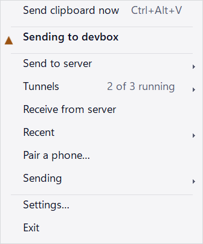
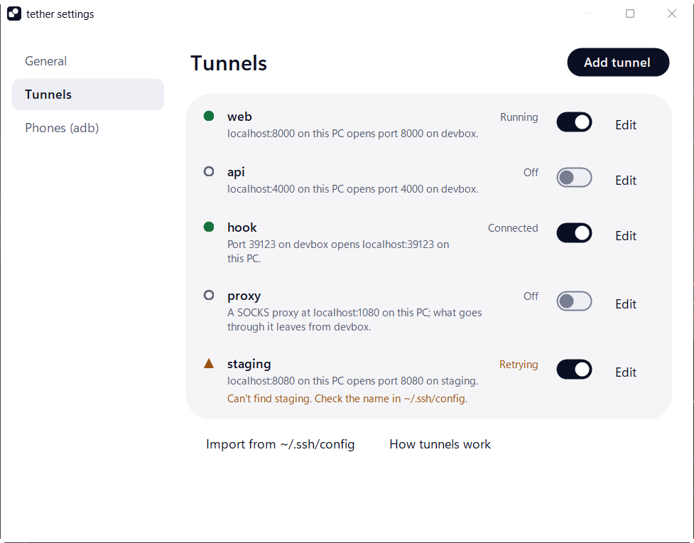
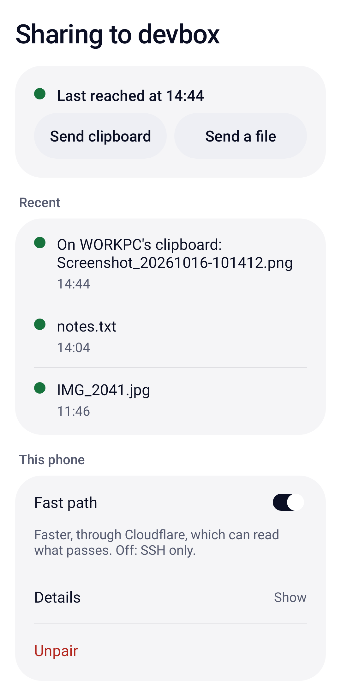

<p align="center">
  <picture>
    <source media="(prefers-color-scheme: dark)" srcset="docs/images/mark-dark.svg">
    
  </picture>
</p>
<h1 align="center">tether</h1>
<p align="center">Paste screenshots and files from Windows into any SSH session.</p>

Terminals paste only text, so Ctrl+V cannot send an image from your PC to a server. tether sits in the
tray, copies each screenshot or file to the server over SSH, and puts its path on your clipboard. Paste
the path into Claude Code, Codex or any other tool, and it opens the file.

It also keeps SSH tunnels open, shares the phones on your desk with adb on the server, brings files
back from the server, and takes shares from an Android phone.

<p align="center"></p>

## Install

You need Windows 10 or 11 and a server you log in to with `ssh <name>` and a key, with no password
prompt. If you don't have that yet, start with [Set up SSH for tether](#set-up-ssh-for-tether).

```powershell
winget install thxnlo.tether
```

Then run `tether` in a new terminal, and its icon appears in the tray. To start it with Windows, turn
on **Start tether when you sign in** in its Settings.

<details>
<summary>Without winget</summary>

Download `tether.exe` from the [latest release](https://github.com/thxnlo/tether/releases/latest) and run
it. The exe is not code-signed, so the first time Windows shows "Windows protected your PC": select
**More info**, then **Run anyway**. Or install it from PowerShell, which skips that dialog:

```powershell
$exe = "$env:LOCALAPPDATA\tether.exe"
$url = "https://github.com/thxnlo/tether" +
  "/releases/latest/download/tether.exe"
irm $url -OutFile $exe
Unblock-File $exe
& $exe
```

`SHA256SUMS` in the release lists each file's checksum.
</details>

**On an Android phone**, install `tether.apk` from the
[latest release](https://github.com/thxnlo/tether/releases/latest). The phone also needs a small script
on the server: [Android setup](docs/android.md).

## Set up SSH for tether

tether logs in with your own SSH key and `~/.ssh/config`, the same ones the `ssh` command uses. Every
upload must log in without a prompt. If `ssh myserver true` already returns without asking for anything,
skip to [First run](#first-run).

1. Make a key in PowerShell on Windows, and accept the defaults:
   ```powershell
   ssh-keygen -t ed25519
   ```
2. Add the key to the server. For user `alice` on `example.test`:
   ```powershell
   type $env:USERPROFILE\.ssh\id_ed25519.pub |
     ssh alice@example.test "mkdir -p ~/.ssh && cat >> ~/.ssh/authorized_keys"
   ```
3. Give the server a short name in `%USERPROFILE%\.ssh\config`:
   ```
   Host myserver
       HostName example.test
       User alice
   ```
4. Check it. This must print nothing and ask for nothing:
   ```powershell
   ssh myserver true
   ```

If step 4 still asks for a password, the key did not reach `~/.ssh/authorized_keys` on the server:
repeat step 2. If it asks about the server's fingerprint, answer `yes` once; tether cannot answer it
for you.

## First run

1. Right-click the tray icon, open **Send to server** and pick your server. The list is the `Host`
   names in your `~/.ssh/config`. Each time tether starts, it checks the connection and says in a
   balloon what to fix if it fails.
2. Take a screenshot with `Win+Shift+S`. The first time, tether asks whether to send every screenshot
   automatically or wait for a click.
3. If it waits, the icon's disc turns into a grey ring: click the icon, or press `Ctrl+Alt+V` in any
   app. When the disc turns green, the path is on the clipboard.
4. Press `Ctrl+V` in the SSH window: Windows Terminal, VS Code, Cursor or any other.

Apps that take images, such as Paint or a chat, still paste the screenshot itself.

## What tether does

### Screenshots and files

<picture>
  <source media="(prefers-color-scheme: dark)" srcset="docs/images/tray-menu-dark.png">
  
</picture>

- **Copy a file** in Explorer and tether sends it the same way, up to 200 MB. Several files paste as
  several paths; folders are skipped.
- **Send to server** picks where uploads go. **Also send copies to** adds more servers; the clipboard
  gets the path on the first.
- **Sending** chooses between asking first, sending every screenshot, and pausing. `Ctrl+Alt+V` sends
  even while paused.
- **Recent** holds the last 10 sends and arrivals. Select one to put it on the clipboard again.
- Uploads go to `/tmp` on the server unless you pick another **Upload folder** in Settings. Clips
  older than a day are deleted from it.

<br clear="right">

The tray icon is tether's mark, and its disc shows how things stand, by shape as well as colour:

| Icon | Means | What to do |
|---|---|---|
|  | Ready | Nothing |
|  | A screenshot is waiting | Click the icon to send it |
|  | Sent: the path is on the clipboard | Paste |
|  | A tunnel, adb or receiving is reconnecting | Usually nothing; the menu says why |
|  | The last upload failed | Click the icon to retry |
|  | A new version is ready | Update from the menu |

Hover over the icon for the same in words, such as "sent 12 s ago → myserver". Balloons appear only for
the connection check, failures, received files and updates.

### Tunnels

<picture>
  <source media="(prefers-color-scheme: dark)" srcset="docs/images/settings-tunnels-dark.png">
  
</picture>

tether keeps SSH port forwards open, and restarts them when the network drops or the PC wakes.
**Tunnels → Add tunnel…** takes a port, or a whole `ssh -L 3000:127.0.0.1:3000 myserver` command.
**Settings → Tunnels** lists each tunnel with its state in words and, when it is down, the reason.
**Tunnels → Copy URL** copies `http://localhost:<port>`. More: [Tunnels](docs/tunnels.md).

### Phones over adb

Turn on **Tunnels → Share phones (adb)** and every Android phone your PC sees, by USB or Wi-Fi, shows up
in `adb devices` on the server. Add **Phone ports** (say `3000`) in **Settings → Phones (adb)**, and
each phone's `localhost:3000` reaches port 3000 on the server, for a dev site in the phone's browser.
More: [Phones over adb](docs/adb.md).

### Files from the server

Turn on **Receive from server** and tether watches a folder on the server, `/tmp/clip-out` unless you
pick another. A file put there lands on your clipboard: an image as the image, short text as text,
anything else in Downloads with its path on the clipboard. So you can ask Claude Code to "put the chart
in /tmp/clip-out". A file name can use letters, digits, spaces, dots, dashes and underscores; tether leaves
any other file where it is.

Only one PC receives from a server at a time. A file that waited more than about a minute goes to
**Recent** and Downloads instead, so it never replaces what you copied since.

### The Android app

<picture>
  <source media="(prefers-color-scheme: dark)" srcset="docs/images/android-paired-dark.png">
  
</picture>

Share a screenshot, photo, file or text from any app to tether, and its path lands on your Windows
clipboard a few seconds later. The phone says "On WORKPC's clipboard" only once a PC has taken it.

Pair the phone from the tray with **Pair a phone…**, which shows a QR code to scan. The phone sends over
SSH, with a key that can only drop files. If your server offers the fast path, shares go over HTTPS
through Cloudflare instead: faster, but Cloudflare can read them. Switch **Fast path** off on the phone
to use SSH only. Setup: [Android](docs/android.md).

<br clear="right">

### Updates

tether looks for a new release on GitHub about once a day. When there is one, it says so once and adds
**Update to tether** with the new version's number to the tray menu. One click downloads it, checks it and restarts tether;
tunnels and adb sharing reconnect by themselves, and the previous version stays beside it as
`tether.exe.old`. The Android app looks when it starts, and Android asks you to confirm the install.

Each release carries the SHA-256 sum of each file, signed with the release key. The apps check that
signature against the public key built into them, then each download's sum. A file that fails either
check is never installed.

## What tether reads and sends

- It reads the clipboard when a screenshot or file is copied, and `~/.ssh/config` for server names.
- It sends only to your servers, through your own `ssh`. Screenshots and files need nothing installed
  on the server.
- It asks GitHub about new releases once a day. There are no accounts and no analytics.
- Its settings are in `%APPDATA%\tether\config.ini`.

## Limits

- Uploads go to the server picked in **Send to server**. If you SSH into several machines or
  containers, pick the one your Claude Code session runs on.
- Phone sharing needs `adb` on the PATH on Windows.
- The exe is not code-signed (see [Install](#install)).

## Docs

- [Tunnels](docs/tunnels.md): each field, the config format, and what to do when a tunnel won't stay up
- [Phones over adb](docs/adb.md): server setup, phone ports, and wireless debugging that survives sleep
- [Android](docs/android.md): server setup, pairing, what each result means, and troubleshooting

---

MIT license. The source is private; this repository holds the releases and the docs. tether was called
copy-to-ssh until version 3.0.
