# tether

Keep your Windows machine tethered to your SSH hosts: paste screenshots
and files into Claude Code or Codex running over SSH, keep port forwards
alive, share your local Android devices with the server, and receive
files back. *(formerly copy-to-ssh)*

The problem: Claude Code runs on your server, your clipboard is on your
Windows machine, and Ctrl+V cannot move an image between them. Terminals
only paste text. tether runs in the tray and bridges the two — when a
screenshot or file is copied, it uploads it over SSH (streamed into
`ssh "cat > file"`, nothing to install on the server) and puts the
remote path on your clipboard, ready to paste into any SSH window.

<p align="center"></p>

## Install

Grab `tether.exe` from the [releases page](https://github.com/thxnlo/tether/releases),
or from PowerShell:

```powershell
irm https://github.com/thxnlo/tether/releases/latest/download/tether.exe -OutFile "$env:LOCALAPPDATA\tether.exe"
Unblock-File "$env:LOCALAPPDATA\tether.exe"
& "$env:LOCALAPPDATA\tether.exe"
```

The exe is unsigned, so SmartScreen may show an "unknown publisher"
warning the first time: click "More info", then "Run anyway"
(`Unblock-File` above avoids it).

## Quick start

1. `Win+Shift+S` as usual
2. The tray icon gets a blue dot — click it (or press `Ctrl+Alt+V`)
3. Green flash → `Ctrl+V` in the SSH window: Windows Terminal, VS Code, Cursor, anything

Right-click the tray icon: the first line shows your state at a glance.
Under *Send to*, click a host to make it the target (read live from
`~/.ssh/config`); right-click extra hosts to broadcast to them too.
The *Sending* menu picks *Ask first* / *Auto-send* / *Paused*.

- Copy a **file** in Explorer and it uploads the same way (200 MB cap).
- **Tunnels**: *Tunnels → Add tunnel...* — pick host, type port, done;
  supervised with keep-alive, auto-reconnect and instant restart after
  sleep. `L`/`R`/SOCKS supported. [Details](docs/tunnels.md)
- **ADB**: *Tunnels → Share ADB devices* makes your phones visible to
  `adb` on the server; wireless devices reconnect automatically.
  [Details](docs/adb.md)
- **Receive**: tick *Receive from server* and anything dropped in
  `/tmp/clip-out` on the host lands on your clipboard or in Downloads.
- Icon states: blue = waiting (click to send), green flash = sent,
  red square = failed (click retries), amber = reconnecting. Toasts
  only for failures and received files. Light/dark theme follows Windows.

## Requirements

Windows 10 or 11 with the built-in OpenSSH client, and key-based auth
to the target host.

## Limitations

Uploads go to the host selected in the tray (plus broadcast hosts). If
you SSH into several machines or containers, pick the one your session
actually runs on. `adb` must be on PATH for device sharing.

---

© 2026 [thxnlo](https://github.com/thxnlo) — MIT license. This repo
hosts releases and documentation; the source is developed privately.
